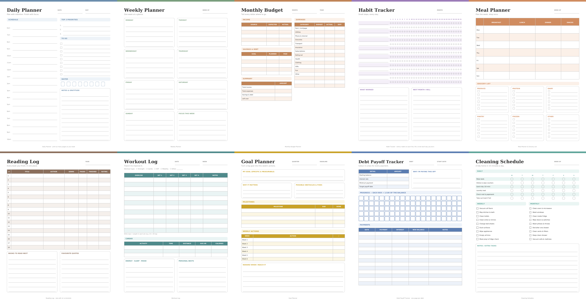

# produkty-cyfrowe-z-claude-

10 gotowych do sprzedaży produktów cyfrowych (printables PDF) na Etsy, Shopify lub Gumroad.



| # | Produkt | Cena (sugerowana) |
|---|---------|-------------------|
| 01 | Daily Planner | $3.49 |
| 02 | Weekly Planner | $2.99 |
| 03 | Monthly Budget Planner | $3.99 |
| 04 | Habit Tracker | $2.49 |
| 05 | Meal Planner & Grocery List | $2.99 |
| 06 | Reading Log | $2.49 |
| 07 | Workout Log | $2.99 |
| 08 | Goal Planner | $2.99 |
| 09 | Debt Payoff Tracker | $2.99 |
| 10 | Cleaning Schedule | $2.99 |

Każdy produkt ma dwa pliki PDF: **US Letter** (USA) i **A4** (Europa) oraz podgląd PNG,
w folderze `products/output/<produkt>/`.

## Opisy do sklepu

`products/LISTINGS.md` zawiera dla każdego produktu gotowy tytuł (≤140 znaków),
opis, 13 tagów (≤20 znaków, limity Etsy) i cenę. Teksty są po angielsku, bo to
największy rynek printables.

## Jak to wygenerować ponownie / zmienić

```bash
pip install reportlab
python3 products/generate.py   # wymaga pdftoppm (poppler-utils) do podglądów
```

- Wygląd i układ stron: funkcje w `products/generate.py` (jedna funkcja na produkt, kolory w `PRODUCTS`).
- Tytuły, tagi, ceny: `products/listings.json` — skrypt sprawdza limity Etsy i odświeża `LISTINGS.md`.

## Przed wystawieniem

- Zrób własne mockupy (np. w Canva) — sam podgląd PNG to za mało na zdjęcie główne.
- Dodaj **pakiet wszystkich 10** jako osobny listing (np. $12.99) — bundle zwykle sprzedaje się najlepiej.
- Na Etsy zaznacz „Digital download” i dołącz oba PDF-y.
