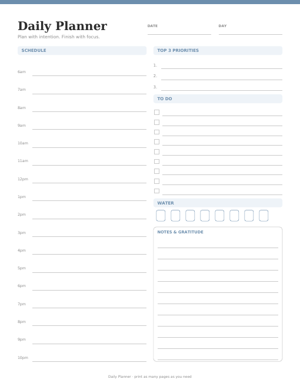
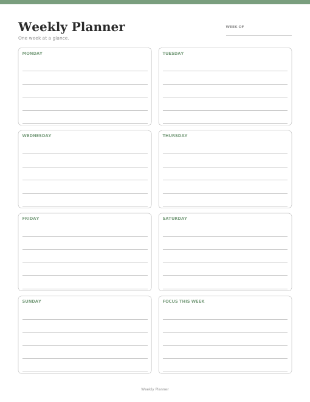
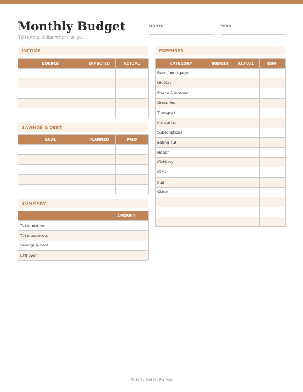
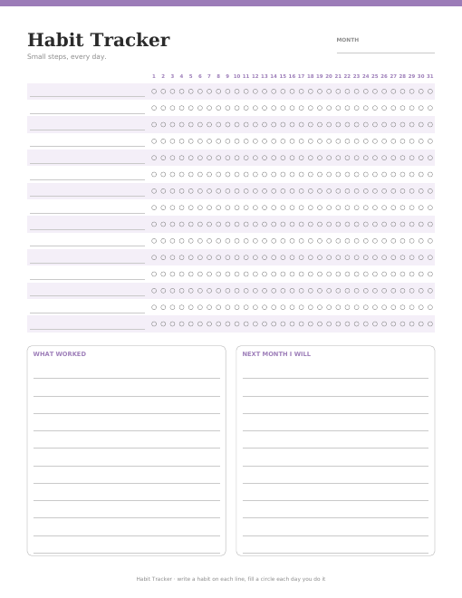
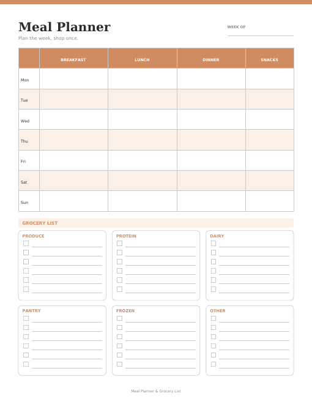
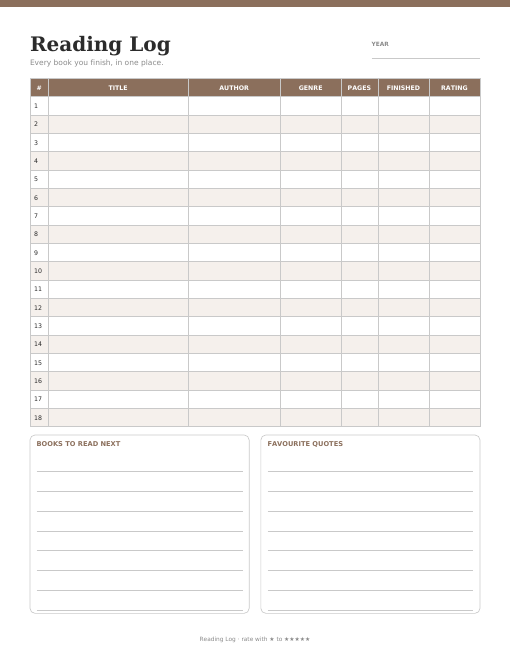
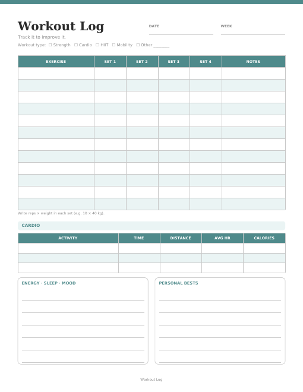
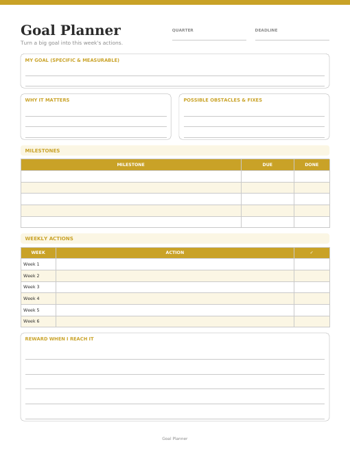
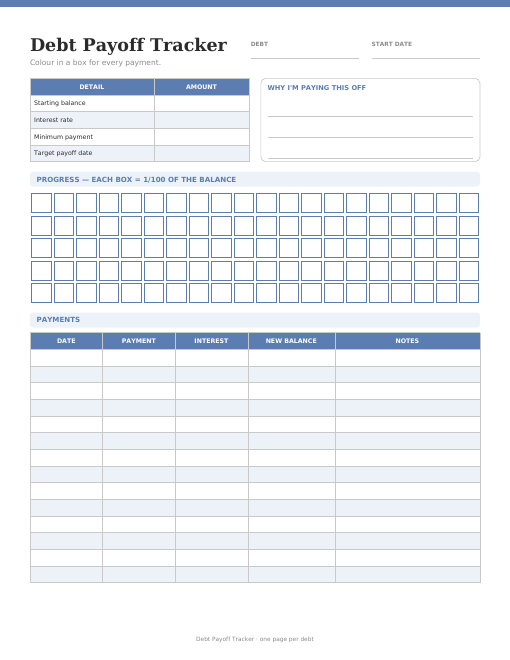
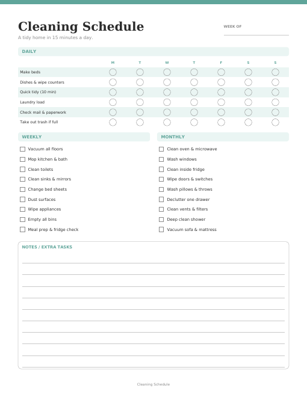

# Listings (Etsy / Shopify)

Generated from `listings.json` by `generate.py`. Copy each block into the listing form.

## 01-daily-planner



**Title** (111/140)

Printable Daily Planner, Undated Hourly Schedule, To Do List & Top 3 Priorities, Minimalist PDF, US Letter & A4

**Price:** $3.49

**Tags:** daily planner, printable planner, undated planner, hourly schedule, to do list, daily schedule, minimalist planner, productivity, work planner, student planner, day planner pdf, planner insert, a4 letter planner

**Description**

```
Plan your day in 5 minutes: hourly schedule from 6am to 10pm, your top 3 priorities, a to-do checklist, water tracker and space for notes & gratitude.

WHAT YOU GET
• 1 PDF in US Letter (8.5 x 11 in)
• 1 PDF in A4 (210 x 297 mm)
• Clean, minimalist design that saves printer ink

HOW IT WORKS
1. Buy and download the files instantly from your purchases page.
2. Print at home or at a print shop, as many times as you like for personal use.
3. Fill it in by hand, or use it in a note-taking app (GoodNotes, Notability, Xodo).

PLEASE NOTE
• This is a digital download. No physical item will be shipped.
• Colours may look slightly different depending on your screen and printer.
• For personal use only. Reselling or sharing the files is not permitted.
```

**Files:** `output/01-daily-planner/01-daily-planner-letter.pdf`, `output/01-daily-planner/01-daily-planner-a4.pdf`

## 02-weekly-planner



**Title** (98/140)

Printable Weekly Planner, Undated Week at a Glance, Minimalist Weekly Schedule PDF, US Letter & A4

**Price:** $2.99

**Tags:** weekly planner, printable planner, week at a glance, undated planner, weekly schedule, weekly to do list, minimalist planner, desk planner, family planner, planner insert, productivity, student planner, weekly organizer

**Description**

```
See your whole week on one page: a box for every day plus a 'Focus this week' section to keep you on track.

WHAT YOU GET
• 1 PDF in US Letter (8.5 x 11 in)
• 1 PDF in A4 (210 x 297 mm)
• Clean, minimalist design that saves printer ink

HOW IT WORKS
1. Buy and download the files instantly from your purchases page.
2. Print at home or at a print shop, as many times as you like for personal use.
3. Fill it in by hand, or use it in a note-taking app (GoodNotes, Notability, Xodo).

PLEASE NOTE
• This is a digital download. No physical item will be shipped.
• Colours may look slightly different depending on your screen and printer.
• For personal use only. Reselling or sharing the files is not permitted.
```

**Files:** `output/02-weekly-planner/02-weekly-planner-letter.pdf`, `output/02-weekly-planner/02-weekly-planner-a4.pdf`

## 03-monthly-budget-planner



**Title** (114/140)

Monthly Budget Planner Printable, Income & Expense Tracker, Savings and Debt, Budget Worksheet PDF, US Letter & A4

**Price:** $3.99

**Tags:** budget planner, monthly budget, budget printable, expense tracker, finance planner, money planner, budget worksheet, savings tracker, bill tracker, household budget, zero based budget, personal finance, budget template

**Description**

```
Tell every dollar where to go: income, 16 expense categories with budget vs actual, savings & debt payments and a month-end summary.

WHAT YOU GET
• 1 PDF in US Letter (8.5 x 11 in)
• 1 PDF in A4 (210 x 297 mm)
• Clean, minimalist design that saves printer ink

HOW IT WORKS
1. Buy and download the files instantly from your purchases page.
2. Print at home or at a print shop, as many times as you like for personal use.
3. Fill it in by hand, or use it in a note-taking app (GoodNotes, Notability, Xodo).

PLEASE NOTE
• This is a digital download. No physical item will be shipped.
• Colours may look slightly different depending on your screen and printer.
• For personal use only. Reselling or sharing the files is not permitted.
```

**Files:** `output/03-monthly-budget-planner/03-monthly-budget-planner-letter.pdf`, `output/03-monthly-budget-planner/03-monthly-budget-planner-a4.pdf`

## 04-habit-tracker



**Title** (95/140)

Printable Habit Tracker, Monthly 31 Day Habit Chart, Goal & Routine Tracker PDF, US Letter & A4

**Price:** $2.49

**Tags:** habit tracker, printable tracker, monthly tracker, habit chart, routine tracker, goal tracker, daily habits, self care planner, wellness tracker, bullet journal, 31 day tracker, productivity, new year goals

**Description**

```
Track up to 15 habits for a full month: fill a circle every day you show up, then reflect on what worked.

WHAT YOU GET
• 1 PDF in US Letter (8.5 x 11 in)
• 1 PDF in A4 (210 x 297 mm)
• Clean, minimalist design that saves printer ink

HOW IT WORKS
1. Buy and download the files instantly from your purchases page.
2. Print at home or at a print shop, as many times as you like for personal use.
3. Fill it in by hand, or use it in a note-taking app (GoodNotes, Notability, Xodo).

PLEASE NOTE
• This is a digital download. No physical item will be shipped.
• Colours may look slightly different depending on your screen and printer.
• For personal use only. Reselling or sharing the files is not permitted.
```

**Files:** `output/04-habit-tracker/04-habit-tracker-letter.pdf`, `output/04-habit-tracker/04-habit-tracker-a4.pdf`

## 05-meal-planner-grocery-list



**Title** (105/140)

Weekly Meal Planner & Grocery List Printable, Menu Planner, Shopping List by Category PDF, US Letter & A4

**Price:** $2.99

**Tags:** meal planner, grocery list, menu planner, meal plan printable, shopping list, weekly meal plan, food planner, kitchen printable, family meal plan, meal prep, diet planner, healthy eating, fridge planner

**Description**

```
Plan breakfast, lunch, dinner and snacks for 7 days, then shop once with a grocery list split into Produce, Protein, Dairy, Pantry, Frozen and Other.

WHAT YOU GET
• 1 PDF in US Letter (8.5 x 11 in)
• 1 PDF in A4 (210 x 297 mm)
• Clean, minimalist design that saves printer ink

HOW IT WORKS
1. Buy and download the files instantly from your purchases page.
2. Print at home or at a print shop, as many times as you like for personal use.
3. Fill it in by hand, or use it in a note-taking app (GoodNotes, Notability, Xodo).

PLEASE NOTE
• This is a digital download. No physical item will be shipped.
• Colours may look slightly different depending on your screen and printer.
• For personal use only. Reselling or sharing the files is not permitted.
```

**Files:** `output/05-meal-planner-grocery-list/05-meal-planner-grocery-list-letter.pdf`, `output/05-meal-planner-grocery-list/05-meal-planner-grocery-list-a4.pdf`

## 06-reading-log



**Title** (107/140)

Printable Reading Log, Book Tracker with Ratings, Reading Journal Page, To Be Read List PDF, US Letter & A4

**Price:** $2.49

**Tags:** reading log, book tracker, reading journal, book log, reading tracker, tbr list, book lover gift, bookish printable, reading challenge, book review, library log, kids reading log, book club

**Description**

```
Keep every book in one place: title, author, genre, pages, date finished and a star rating, plus a 'read next' list and favourite quotes.

WHAT YOU GET
• 1 PDF in US Letter (8.5 x 11 in)
• 1 PDF in A4 (210 x 297 mm)
• Clean, minimalist design that saves printer ink

HOW IT WORKS
1. Buy and download the files instantly from your purchases page.
2. Print at home or at a print shop, as many times as you like for personal use.
3. Fill it in by hand, or use it in a note-taking app (GoodNotes, Notability, Xodo).

PLEASE NOTE
• This is a digital download. No physical item will be shipped.
• Colours may look slightly different depending on your screen and printer.
• For personal use only. Reselling or sharing the files is not permitted.
```

**Files:** `output/06-reading-log/06-reading-log-letter.pdf`, `output/06-reading-log/06-reading-log-a4.pdf`

## 07-workout-log



**Title** (107/140)

Printable Workout Log, Gym Tracker, Strength & Cardio Fitness Journal, Exercise Planner PDF, US Letter & A4

**Price:** $2.99

**Tags:** workout log, fitness tracker, gym log, workout planner, exercise log, fitness journal, strength training, weight lifting log, cardio tracker, fitness planner, gym tracker, personal trainer, home workout

**Description**

```
Log 12 exercises with 4 sets each, your cardio sessions, energy, sleep, mood and personal bests, all on one page.

WHAT YOU GET
• 1 PDF in US Letter (8.5 x 11 in)
• 1 PDF in A4 (210 x 297 mm)
• Clean, minimalist design that saves printer ink

HOW IT WORKS
1. Buy and download the files instantly from your purchases page.
2. Print at home or at a print shop, as many times as you like for personal use.
3. Fill it in by hand, or use it in a note-taking app (GoodNotes, Notability, Xodo).

PLEASE NOTE
• This is a digital download. No physical item will be shipped.
• Colours may look slightly different depending on your screen and printer.
• For personal use only. Reselling or sharing the files is not permitted.
```

**Files:** `output/07-workout-log/07-workout-log-letter.pdf`, `output/07-workout-log/07-workout-log-a4.pdf`

## 08-goal-planner



**Title** (116/140)

Goal Planner Printable, Goal Setting Worksheet, Milestones & Weekly Action Plan, Quarterly Goals PDF, US Letter & A4

**Price:** $2.99

**Tags:** goal planner, goal setting, goal worksheet, action plan, smart goals, quarterly goals, vision planner, life planner, goal tracker, productivity, new year planner, personal growth, business goals

**Description**

```
Turn one big goal into this week's actions: your why, obstacles and fixes, 5 milestones, a 6-week action plan and the reward you'll earn.

WHAT YOU GET
• 1 PDF in US Letter (8.5 x 11 in)
• 1 PDF in A4 (210 x 297 mm)
• Clean, minimalist design that saves printer ink

HOW IT WORKS
1. Buy and download the files instantly from your purchases page.
2. Print at home or at a print shop, as many times as you like for personal use.
3. Fill it in by hand, or use it in a note-taking app (GoodNotes, Notability, Xodo).

PLEASE NOTE
• This is a digital download. No physical item will be shipped.
• Colours may look slightly different depending on your screen and printer.
• For personal use only. Reselling or sharing the files is not permitted.
```

**Files:** `output/08-goal-planner/08-goal-planner-letter.pdf`, `output/08-goal-planner/08-goal-planner-a4.pdf`

## 09-debt-payoff-tracker



**Title** (111/140)

Debt Payoff Tracker Printable, Debt Snowball Coloring Chart, Loan & Credit Card Payment Log PDF, US Letter & A4

**Price:** $2.99

**Tags:** debt payoff, debt tracker, debt snowball, debt free, payoff tracker, loan tracker, credit card debt, savings challenge, finance tracker, budget printable, money tracker, debt avalanche, coloring tracker

**Description**

```
Watch your debt disappear: colour in one of 100 boxes for every 1% paid off and log each payment, interest and new balance.

WHAT YOU GET
• 1 PDF in US Letter (8.5 x 11 in)
• 1 PDF in A4 (210 x 297 mm)
• Clean, minimalist design that saves printer ink

HOW IT WORKS
1. Buy and download the files instantly from your purchases page.
2. Print at home or at a print shop, as many times as you like for personal use.
3. Fill it in by hand, or use it in a note-taking app (GoodNotes, Notability, Xodo).

PLEASE NOTE
• This is a digital download. No physical item will be shipped.
• Colours may look slightly different depending on your screen and printer.
• For personal use only. Reselling or sharing the files is not permitted.
```

**Files:** `output/09-debt-payoff-tracker/09-debt-payoff-tracker-letter.pdf`, `output/09-debt-payoff-tracker/09-debt-payoff-tracker-a4.pdf`

## 10-cleaning-schedule



**Title** (107/140)

Cleaning Schedule Printable, Daily Weekly Monthly Cleaning Checklist, House Chore Chart PDF, US Letter & A4

**Price:** $2.99

**Tags:** cleaning schedule, cleaning checklist, chore chart, cleaning planner, house cleaning, home organization, weekly cleaning, household planner, cleaning printable, chore list, home planner, speed cleaning, cleaning routine

**Description**

```
A tidy home in 15 minutes a day: daily tasks for each day of the week, plus weekly and monthly checklists and space for extra chores.

WHAT YOU GET
• 1 PDF in US Letter (8.5 x 11 in)
• 1 PDF in A4 (210 x 297 mm)
• Clean, minimalist design that saves printer ink

HOW IT WORKS
1. Buy and download the files instantly from your purchases page.
2. Print at home or at a print shop, as many times as you like for personal use.
3. Fill it in by hand, or use it in a note-taking app (GoodNotes, Notability, Xodo).

PLEASE NOTE
• This is a digital download. No physical item will be shipped.
• Colours may look slightly different depending on your screen and printer.
• For personal use only. Reselling or sharing the files is not permitted.
```

**Files:** `output/10-cleaning-schedule/10-cleaning-schedule-letter.pdf`, `output/10-cleaning-schedule/10-cleaning-schedule-a4.pdf`
